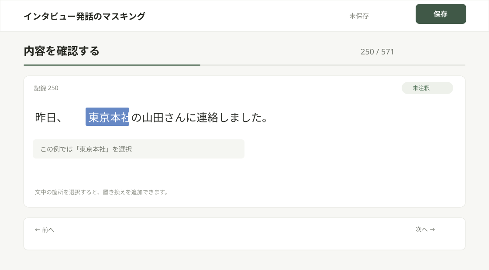
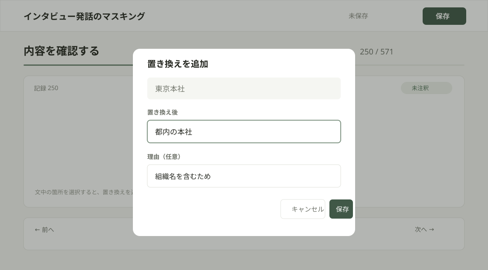
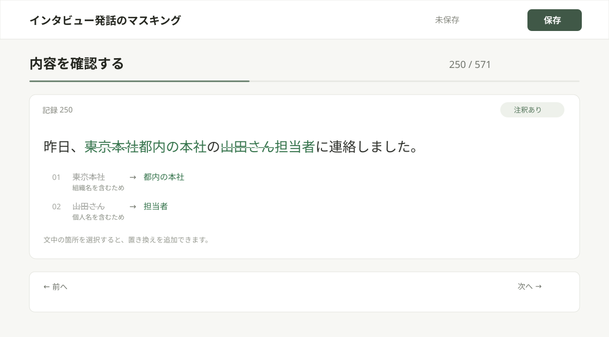
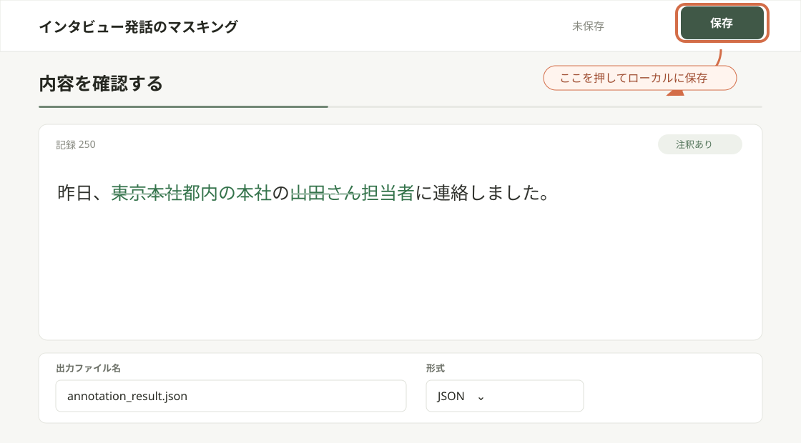
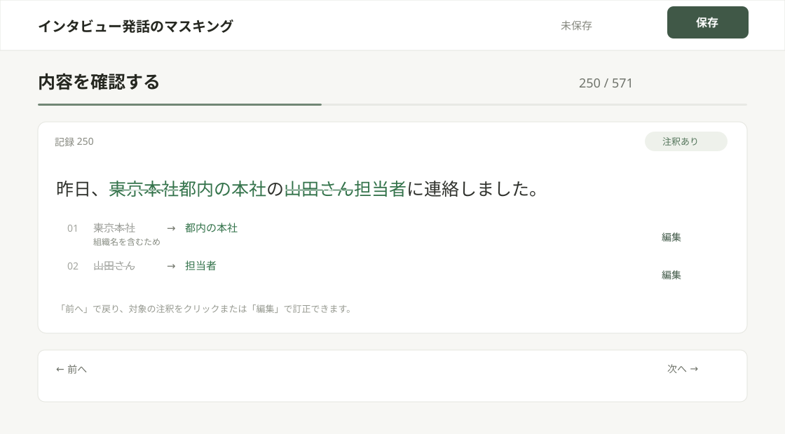
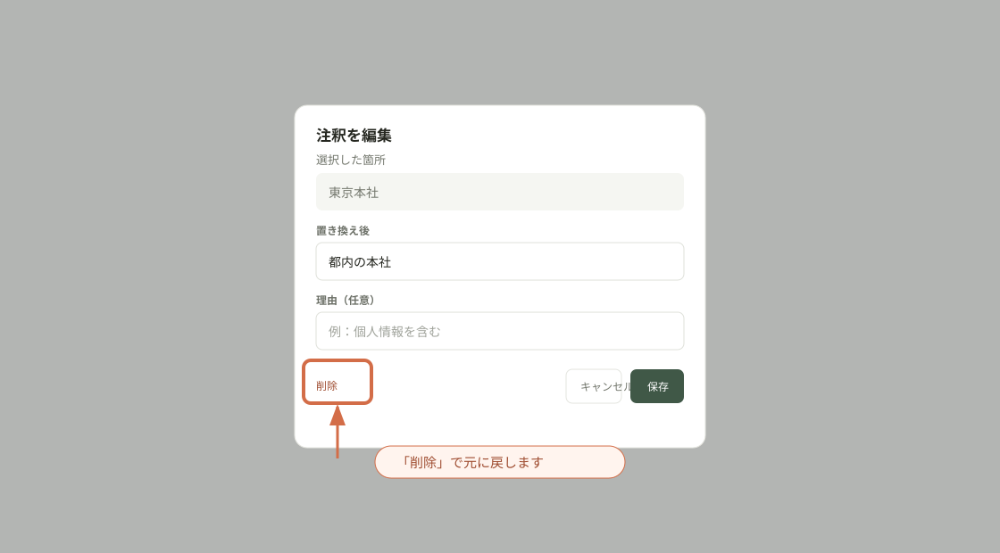
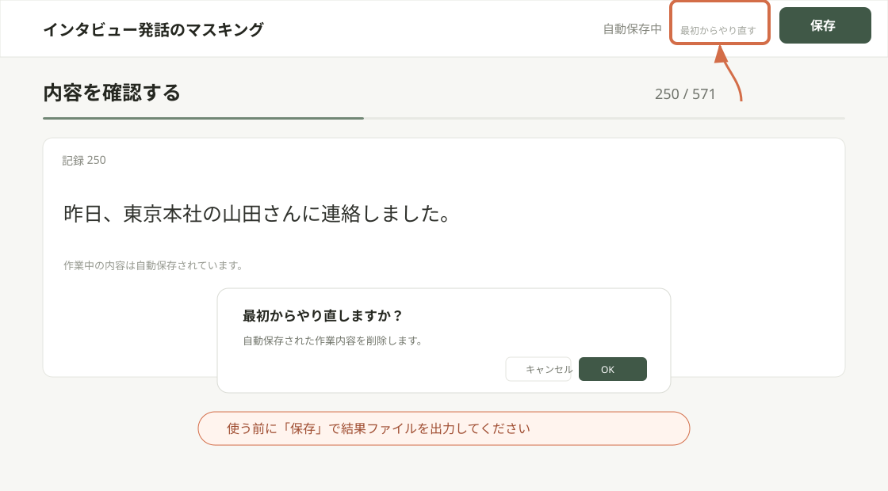

# インタビュー発話のマスキング

**重要：Webページを閉じる前に必ず「保存」ボタンを押して結果を出力してください。**

画面例は説明用の架空の発話です。実際の作業では、お送りした `interview.csv` を使用してください。

## 作業手順

1. お送りした `interview.csv` をお手元に用意します。
2. Webページの案内を確認して「OK」を押し、「ファイルを選択」から `interview.csv` を選びます。
3. 作業を始める行番号を入力して「アノテーション開始」を押します。行番号は1から数えます。
4. 発話中の隠したい箇所をドラッグして選択します。

   

   例：「東京本社」をドラッグして選択します。

5. 置き換え後の文字列を入力します。理由は必要に応じて入力し、注釈を保存します。

   

   選択した箇所と置き換え後の文字列を確認して保存します。

6. 同じ発話にほかの対象箇所があれば、同じ手順で注釈を追加します。

   

   同じ発話に2箇所の注釈を付けた例です。

7. 「前へ」「次へ」、またはキーボードの左右キーで発話を移動して作業します。既存の注釈はクリックして編集できます。
8. 作業後、出力形式とファイル名を確認し、画面右上の「保存」を押します。

   

   出力形式・ファイル名を確認し、画面右上の「保存」を押します。
9. ローカルに保存されたアノテーション結果ファイルをお送りください。

## 回答済みのデータを訂正する場合

- 注釈の内容を訂正する場合は、「前へ」で該当の発話に戻り、発話中の注釈または一覧の「編集」をクリックして、置き換え後の文字列を修正して保存します。

  

- 注釈を付ける前の状態に戻す場合は、同じ編集画面の「削除」を押してください。注釈が取り消され、元の発話に戻ります。

  

- 最初からやり直す場合は、必要な注釈を必ず「保存」で結果ファイルに出力してから、画面右上端の小さな「最初からやり直す」を押します。確認後に自動保存データが削除され、初期画面へ戻ります。その後、CSVと開始番号を選び直してください。

  

## 注意事項

- データは全部で571件です。途中から作業する場合は、手順3で開始番号を指定してください。たとえば250件目から最後まで作業する場合は「250」を入力します。
- 作業する範囲の最後まで進んだら、「保存」を押して終了してください。たとえば250件目から350件目まで作業する場合は、250から開始し、350件目の作業後に保存します。
- 開始番号より前の発話には戻れません。
- 保存すると、作業中に付けた注釈がファイルとしてダウンロードされます。既定の形式はJSON、ファイル名は `annotation_result.json` です。必要に応じてYAMLや別のファイル名に変更できます。

## お願い

マスキングによる情報損失をできるだけ抑えられるよう、可能な範囲で単語単位に、マスキング箇所を最小限にしていただけると助かります。

## CSVについて

- アノテーション対象は、お送りした `interview.csv` です。

## データの保存

CSVと注釈データはこのブラウザのローカルストレージに自動保存されます。ページを再読み込みすると、作業中の状態が自動的に復元されます。アノテーション対象や注釈をサーバーへ送信する処理はありません。結果は「保存」を押すとローカルにダウンロードされます。ダウンロードした結果ファイルをお送りください。
